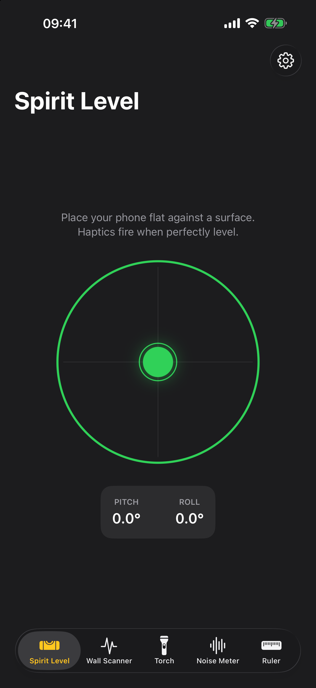
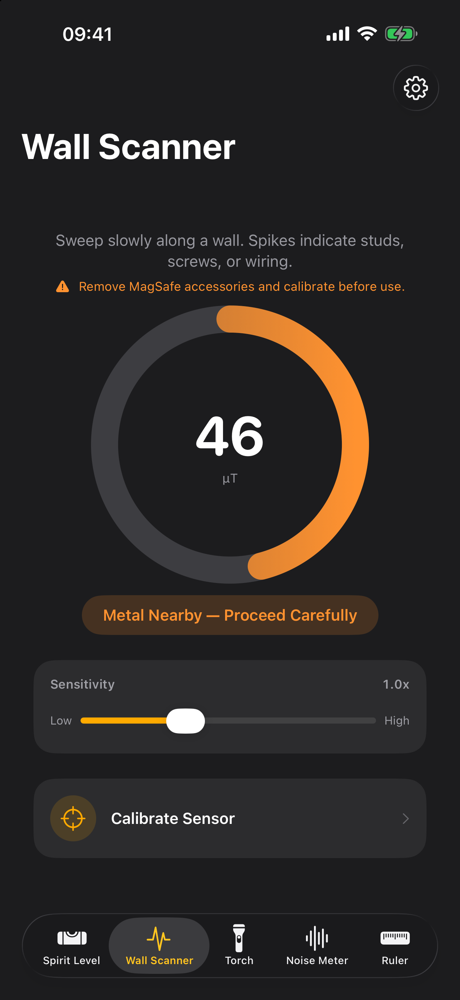
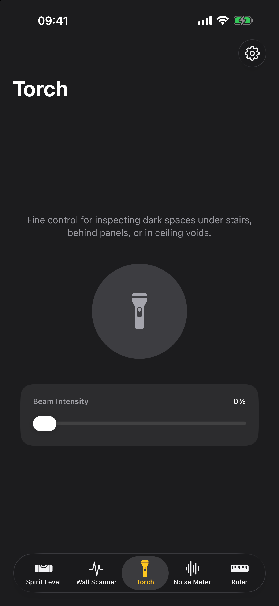
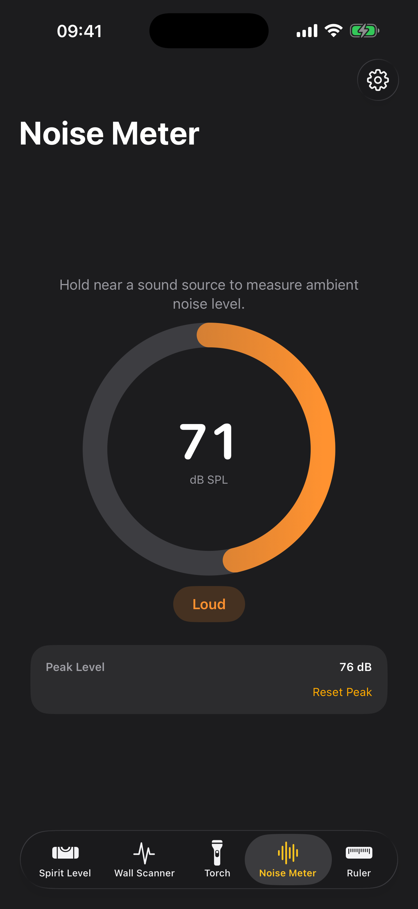
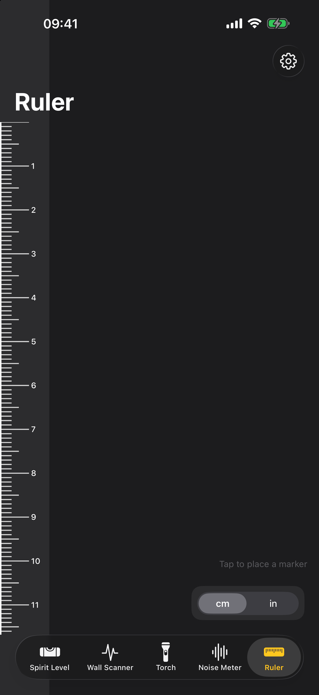

  

<h1 align="center">DIY Companion</h1>

  A free, ad-free iOS utility app for everyday DIY tasks. 
  Five precision tools in one lightweight app.

  
  
  
  

---

## Screenshots

| Spirit Level | Wall Scanner | Torch | Noise Meter | Ruler |
|:---:|:---:|:---:|:---:|:---:|
|  |  |  |  |  |

---

## Tools

### 🔵 Spirit Level
Uses the iPhone's motion sensors to display a real-time bubble level. Lay the phone flat for a classic bubble level, or hold it upright against a wall or door frame and it automatically switches to a **plumb mode** — a dedicated tube level with a tilt-from-vertical readout. Adapts to both portrait and landscape orientation, and a haptic pulse fires the moment the device is perfectly level or plumb.

### 📡 Wall Scanner
Uses the iPhone's magnetometer to detect metal objects behind walls — studs, screws, pipes, and wiring. Automatically calibrates to the ambient magnetic field on launch so readings are relative to your environment, not Earth's field. Adjustable sensitivity slider for different wall materials and conditions. Haptic pulses fire as the reading crosses into the caution and danger bands, so you can keep your eyes on the wall while sweeping. A one-time safety disclaimer explains the tool's limits before first use.

> **Note:** Remove MagSafe accessories before scanning. The ring magnets will interfere with readings. Run a fresh calibration before each scan. A magnetometer only detects ferrous metal — it cannot see plastic pipes or non-metallic materials, so always confirm with a professional-grade detector before drilling.

### 🔦 Torch / Flashlight
Fine-grained brightness control over the rear camera flash — useful for inspecting dark spaces under stairs, behind panels, or in ceiling voids. The tool name adapts to your device language: *Torch* for British English, *Flashlight* for US English.

### 🔊 Noise Meter
Uses the iPhone's microphone to measure ambient sound levels in real time. Displays an approximate dB SPL reading, a colour-coded tier badge (Quiet / Moderate / Loud / Dangerous), and a resettable peak level marker. Useful for checking noise levels on a job site or inside a room before and after insulation work.

### 📏 Ruler
Turns the iPhone screen into a calibrated physical ruler. Uses a per-device PPI lookup table to ensure accurate tick marks in both centimetres and inches. Automatically switches the ruler from the left edge (portrait) to the top edge (landscape) so the longest side of the phone is always used.

Tap anywhere on the ruler to place a measurement marker. Tap again to place a second marker. Drag either marker to reposition. When both markers are set, the span between them is calculated automatically. Tap **Copy** to copy the measurement to the clipboard. Markers are also fully operable with VoiceOver.

---

## Settings

A built-in Settings screen lets you choose the app theme (System, Light, or Dark), set your default measurement units (metric or imperial), and toggle haptic feedback on or off. The app follows your system appearance by default.

## Privacy

DIY Companion runs entirely on your device — no account, no ads, no analytics, no tracking, and no network requests. Microphone audio is metered live to show the reading and is never recorded, stored, or shared. The bundled privacy manifest declares no collected data.

---

## Requirements

- iOS 17+
- Physical device required for Wall Scanner (magnetometer not available in Simulator)
- Microphone permission required for Noise Meter

## Tech Stack

| Framework | Used for |
|-----------|----------|
| SwiftUI | All UI |
| CoreMotion | Accelerometer (spirit level), magnetometer (wall scanner) |
| AVFoundation | Torch control, microphone metering (noise meter) |
| UIKit | Haptic feedback, screen PPI metrics, appearance override |
| StoreKit | System "rate this app" prompt |

## Building

Open `DIYCompanion.xcodeproj` in Xcode 15 or later and run on a connected device.

## License

[cttech.io Open License](LICENSE) — source available for personal and educational use; commercial distribution (including App Store submission) requires written permission from cttech.io.
